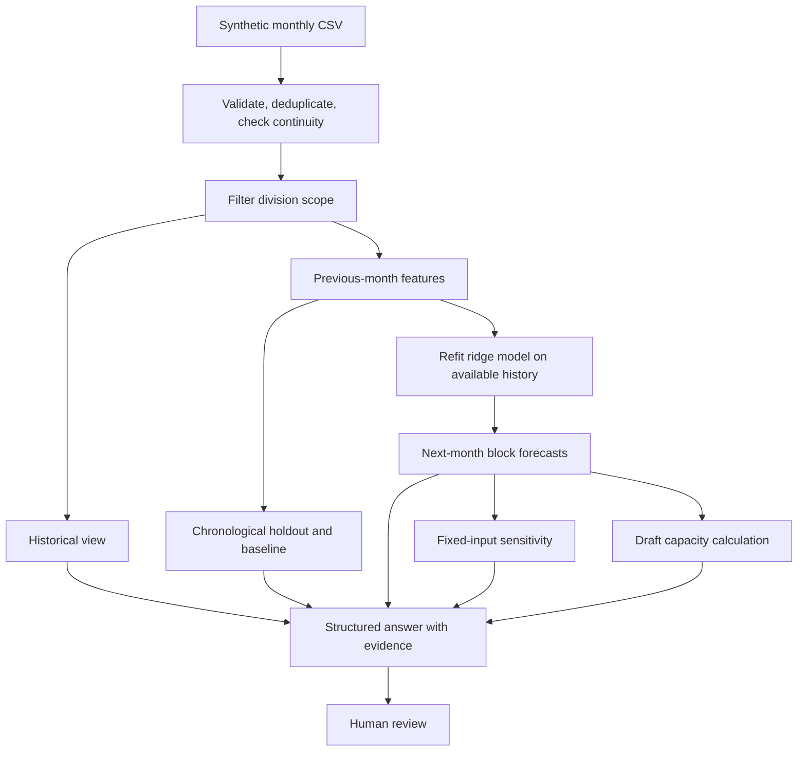

# Yield Prediction Assistant

A runnable portfolio demo for monthly oil-palm yield forecasting, historical queries, model sensitivity and harvest-capacity planning. It trains a small regression model on synthetic observations, compares it with a previous-month baseline on a chronological holdout, and returns forecasts with source records and model explanations.

**Python 3.11+ · standard library only · no API keys · synthetic data only**

Portfolio owner: Frederick Alfhendra. This standalone adaptation was developed with AI assistance for implementation, tests and documentation. It demonstrates a workflow inspired by a customer-site project without distributing customer artifacts, identifiers, credentials or infrastructure details. It does not reproduce customer models or claim their reported performance.

## Quick start

From the repository root:

```sh
python -m yield_prediction ask samples/history.csv "forecast next month" --as-of 2026-09
python -m yield_prediction ask samples/history.csv "prediksi bulan depan" --as-of 2026-09 --role field --division DIV_A
python -m yield_prediction ask samples/history.csv "show model evaluation" --as-of 2026-09
python -m unittest discover -s tests -v
```

Use `py -3` instead of `python` on Windows if needed. No dependency installation, cloud account or model download is required. Every run fits from the supplied history; there is no hidden pretrained model or service.

```sh
python -m yield_prediction ask samples/history.csv "show historical yield" --as-of 2026-09
python -m yield_prediction ask samples/history.csv "simulate lower rainfall" --as-of 2026-09
python -m yield_prediction ask samples/history.csv "buat rencana panen" --as-of 2026-09 --planning samples/planning.json --output data/plan.json
python -m yield_prediction questions
```

## Sample input and generated output

[history.csv](samples/history.csv) contains 192 fictional observations: four blocks in two divisions, each with 48 monthly records from October 2022 through September 2026. The deterministic generator uses seed 1729. No observed customer values are included.

The input columns are:

```csv
record_id,division,block,month,area_ha,palm_age_years,rainfall_mm,fertilizer_kg_ha,upkeep_pct,yield_t_ha
```

`yield_t_ha` means harvested fresh-fruit-bunch tonnes per hectare **for that month**, not annual yield. `area_ha` converts yield into production tonnes. Rainfall, fertilizer and upkeep describe the observed month; the model uses them only as previous-month features.

The actual all-division October 2026 forecast is:

| Division | Block | Area ha | Predicted t/ha/month | Predicted tonnes |
|---|---|---:|---:|---:|
| DIV_A | A01 | 40 | 1.798583 | 71.943308 |
| DIV_A | A02 | 55 | 1.744897 | 95.969318 |
| DIV_B | B01 | 35 | 1.788410 | 62.594366 |
| DIV_B | B02 | 60 | 1.714420 | 102.865217 |
| **Total** | | **190** | | **333.372209** |

Displayed yield and production are rounded independently. Every block output includes its September source record, feature values, linear contributions, clipping indicator and any feature outside the training range. B02 flags upkeep and age extrapolation in this example. Contributions describe the model calculation, not causal effects.

The capacity example uses the explicit assumptions in [planning.json](samples/planning.json): 24 working days and 1.2 tonnes per worker-day. The resulting rounded-up daily worker counts are 3, 4, 3 and 4 for A01, A02, B01 and B02. This is a draft uniform-capacity calculation, not a harvest schedule or optimized staffing recommendation.

| Scenario | Actual generated response |
|---|---|
| Management forecast | [output_forecast.json](samples/output_forecast.json) |
| Indonesian field forecast for DIV_A | [output_field.json](samples/output_field.json) |
| Historical yield summary | [output_history.json](samples/output_history.json) |
| Holdout evaluation | [output_evaluation.json](samples/output_evaluation.json) |
| Lower-rainfall sensitivity | [output_scenario.json](samples/output_scenario.json) |
| Draft capacity plan | [output_plan.json](samples/output_plan.json) |
| Unsupported fertilizer recommendation | [output_unsupported.json](samples/output_unsupported.json) |
| Missing division scope | [output_invalid_scope.json](samples/output_invalid_scope.json) |

Regenerate these outputs with `python scripts/generate_samples.py`. Regenerate the synthetic fixture with `python scripts/generate_fixture.py`. These scripts overwrite the named sample files only. JSON output limits floating-point serialization to eight decimal places; calculations use full precision internally.

## Model and evaluation

The model is ridge regression with fixed regularization `alpha=1.0`. Seven predictors are used: previous-month yield, rainfall, fertilizer, upkeep and palm age, plus sine and cosine of the known target calendar month. Features are standardized using the training partition only; the intercept is not penalized. The tiny linear system is solved with partial-pivot Gaussian elimination using the Python standard library.

The last six observed months form the holdout. For this fixture, evaluation trains on target months through March 2026 and tests April–September 2026 across four blocks: 164 training examples and 24 holdout predictions. The evaluation model stays fixed across the holdout, while each prediction receives the actual previous month's observations available at that prediction origin. It therefore evaluates **successive one-month forecasts**, not a single six-month forecast.

| Synthetic holdout measure | Ridge | Previous-month baseline |
|---|---:|---:|
| MAE, tonnes/ha/month | 0.046992 | 0.208171 |
| RMSE, tonnes/ha/month | 0.057729 | 0.241301 |
| WAPE, percent | 1.9294 | 8.5471 |

These are synthetic engineering results. The fixture was generated using a simple lagged linear relationship, which deliberately suits the demonstration model. This comparison does not establish real-world forecasting quality. WAPE is an error measure, not an accuracy percentage. The model is not automatically selected or tuned using the holdout results.

After evaluation, a separate model is fitted on all 188 available supervised examples to predict October. This final model is serialized in the answer with its training cutoff, scaling parameters, ranges and coefficients. Negative outputs are clipped to zero and flagged. There is no calibrated prediction interval and no automatic model deployment or retraining service.

## Architecture



Division filtering happens before feature generation, scaling, model fitting, evaluation and provenance generation. A field request for DIV_A cannot use DIV_B values to train the model. Management fits a pooled model over all selected blocks; a field-scoped model can therefore produce different predictions for the same block. This is deliberate, and the reported scope and training counts make it visible.

The CLI role and division are simulation parameters, **not authentication**. A local user can choose management mode or read the source file. A production service would derive scope from verified identity and enforce it at data and model-access boundaries. See [architecture decisions](docs/ARCHITECTURE.md).

## Supported questions

| Intent | English | Indonesian |
|---|---|---|
| Forecast | `forecast next month` | `prediksi bulan depan` |
| History | `show historical yield` | `tampilkan hasil historis` |
| Evaluation | `show model evaluation` | `tampilkan evaluasi model` |
| Sensitivity | `simulate lower rainfall` | `simulasi curah hujan lebih rendah` |
| Capacity plan | `draft harvest plan` | `buat rencana panen` |

The assistant uses exact supported phrases after normalizing case, whitespace and final punctuation. It is a bounded router around trained ML, not an LLM or general conversational agent. Both languages return the same structured schema. Unsupported questions abstain explicitly, including treatment recommendations.

The sensitivity example reduces the **previous-month rainfall input** by 20%, holds the other features fixed, and runs the same fitted model. It changes total predicted production by -7.692889 tonnes in the synthetic example. It is a hypothetical input perturbation, not a weather forecast, causal estimate or recommendation to change field conditions.

## Input contract

Use the exact CSV headers and ordering shown above. All IDs are uppercase letters, digits, underscores or hyphens, begin with a letter, and are at most 40 characters. Each selected block must contain at least 36 consecutive months ending at `--as-of`. Different start months are allowed. The forecast assumes those month-end observations are available when forecasting begins; no reporting-delay model is implemented. Future rows relative to `--as-of`, internal gaps and stale blocks fail validation rather than being silently imputed.

| Numeric field | Accepted demo range |
|---|---|
| area_ha | 0.01–10,000; constant per block |
| palm_age_years | 3–40 |
| rainfall_mm | 0–2,000 per month |
| fertilizer_kg_ha | 0–1,000 per month |
| upkeep_pct | 0–100 |
| yield_t_ha | 0–10 per month |

Values must be finite. These bounds are contract checks, not agronomic standards. Exact duplicate IDs are removed; conflicting IDs and duplicate block-months with different IDs are rejected. The file limit is 5 MB and 10,000 records. Scope is applied after basic row validation but before continuity checks and all modeling. The demo does not handle changing block areas, replanting transitions, missing observations or yield aggregation across incompatible units.

## Tests and reliability

Run `python -m unittest discover -s tests -v`. Twenty tests cover the linear solver, known metrics, lag construction, chronological splits, training-only scaling, holdout-target leakage, division isolation, bilingual aliases, source evidence, scenario invariants, capacity arithmetic, duplicates, missing months, invalid values, extrapolation, clipping and public CLI execution.

Invalid data, missing scope and local I/O failures return structured errors with exit code 1. Unsupported questions return `unsupported_question` with exit code 0. Output cannot overwrite the input CSV or planning JSON. No customer files or model binaries are read at runtime. See [validation record](docs/VALIDATION.md).

## Repository map

```text
yield_prediction/
  data.py          Monthly contract, continuity and scope
  model.py         Lag features, ridge fitting and holdout metrics
  workflow.py      Forecast, history, sensitivity and planning
  __main__.py      CLI and structured output
samples/           Synthetic history, assumptions and eight generated outputs
scripts/           Reproducible fixture and output generators
tests/             Model, validation, scope and CLI tests
docs/              Architecture, validation and portfolio description
```

The implementation is intentionally small enough to discuss in a technical assessment. [Portfolio notes](docs/PORTFOLIO.md) explain the demonstration and contribution boundaries. Production work would require real-data evaluation, agronomic review, authenticated access, drift monitoring, uncertainty calibration, approved data retention and operational review processes.
